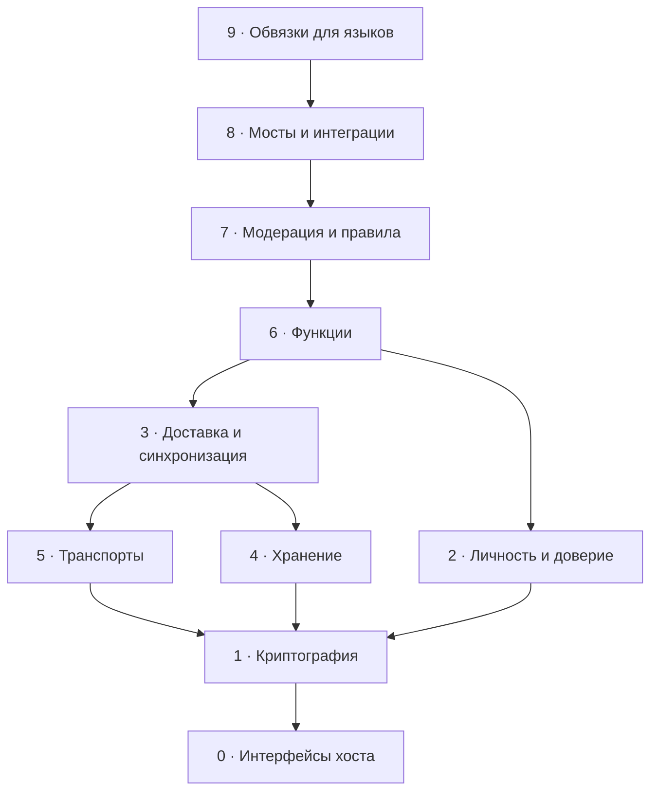

# Дорожная карта ядра

## Модульное ядро

Сейчас ядро разделено по слоям (крейты), но по функциям монолитно:

- `shum-core` (около 18 500 строк) держит рядом основу (шифрование,
  подписи, пакеты, Noise, Nostr), личность (карточки, профиль,
  приглашения, бэкап, аватарки), доставку (`engine.rs`, очередь, правила)
  и функции (фото, присутствие, общий чат, каталог стикеров).
- `shum-session/src/machine.rs` обрабатывает все 40 видов запросов в одной
  развилке; каждая новая функция дописывается в `engine`, `machine` и снимок.

Из-за этого функцию нельзя выключить настройкой, совместимость со старыми
клиентами делается вручную для каждой функции, любая правка пересобирает
всё ядро, а веб везёт в себе код, который ему не нужен.

### Цель

- **Ядро-основа**, которое меняется редко: ключи и шифрование, контакты и
  приглашения, доставка с очередью, хранилище.
- **Модули функций** поверх основы: сообщения, реакции, стикеры, фото,
  присутствие, общий чат; позже рейтинг живого профиля, звонки, группы.
  У модуля свои виды пакетов с версией, свой раздел хранилища, свои
  запросы, свой кусок снимка и свои тесты.
- **Один интерфейс модуля** между ними: запросы, входящие пакеты,
  состояние, снимок.
- **Транспорты тоже модули**: Nostr, Bluetooth, позже Tor и Wi-Fi рядом.
- **Возможности в карточке**: клиент сообщает, какие модули и версии он
  понимает, и старые клиенты получают понятную им замену без отдельной
  работы для каждой функции.

### Что это даёт

- Функции включаются и выключаются настройкой, без правок по коду.
- Каждый клиент собирает только нужные модули через Cargo-features.
- Правка модуля не пересобирает основу, сборки быстрее.
- Модули не задевают друг друга и тестируются по отдельности.
- Новые функции добавляются рядом, а не дописываются в `machine.rs`.
- По понятному интерфейсу можно сделать свой клиент или модуль.

### Шаги

Постепенно, без переписывания с нуля; после каждого шага все тесты зелёные
и сборки проверены на телефонах.

- [ ] Описать интерфейс модуля и разрезать развилку в `machine.rs` по
      функциям, пока в тех же крейтах
- [ ] Вынести общий чат первым модулем, вместе с флагом «включён или
      выключен»
- [ ] Вынести каталог стикеров и реакций в модуль с данными, а не кодом
- [ ] Вынести фото и присутствие
- [ ] Добавить в карточку список поддерживаемых модулей и версий
      (продумать в Shum Protocol)
- [ ] Разнести модули по своим крейтам и подключать через Cargo-features
- [ ] Транспорты за общим интерфейсом: Nostr и Bluetooth, место для Tor и
      Wi-Fi рядом

## Возможные модули

Каталог того, что может понадобиться, если кто-то соберёт из ядра своё
средство связи: без центра, централизованное, на своём сервере,
корпоративное или без сети вообще. Слой зависит только от слоёв ниже.
Сейчас делать всё это не нужно; важно не закрыть для этого место.

**Есть** значит уже работает в Shum; остальное заложить наперёд.

| Слой | Есть | Заложить наперёд |
| :--- | :--- | :--- |
| 9. Обвязки | Swift (UniFFI), JS (WebAssembly), служба с IPC | Kotlin (UniFFI), C ABI, Go, C# / .NET, Python, HTTP API службы |
| 8. Мосты | | Matrix, XMPP, email, Telegram, боты и webhooks, SSO (OIDC, SAML), каталог SCIM / LDAP, календарь и задачи |
| 7. Модерация | | жалобы, фильтры и антиспам, политики админа, срок хранения, журнал аудита, юридическое удержание, выгрузка для проверок, DLP-проверки |
| 6. Функции | текст и ответы, удаление, реакции, стикеры, фото, присутствие, общий чат рядом | редактирование, файлы, голосовые, видео-кружки, группы, каналы, звонки, исчезающие, опросы, геометки, сторис, рейтинг профиля |
| 5. Транспорты | реле Nostr, Bluetooth mesh | Wi-Fi рядом и LAN, Tor, свой сервер (WebSocket), HTTP-опрос, WebRTC P2P, LoRa и Meshtastic, QR и файл вручную |
| 4. Хранение | шифрованные записи, SQLite, IndexedDB, бэкап и экспорт, медиа по частям | память, серверное хранилище, локальный поиск, срок жизни данных |
| 3. Доставка | очередь и повторы, доставлено и прочитано, порядок и дубли, пуш-пробуждение, маршруты mesh | курьеры, синхронизация истории, лимиты и защита от флуда, UnifiedPush и FCM |
| 2. Личность | подписанные карточки, контакты и приглашения, блокировка, несколько устройств, сверка ключа по QR | имена и Shum ID, подтверждения встреч, рейтинг доверия, каталог организации |
| 1. Криптография | ключи и подписи, запечатанный конверт, Noise XX | Double Ratchet, MLS для групп, постквантовый KEM, восстановление по частям, прозрачность ключей |
| 0. Интерфейсы хоста | часы, случайность, хранилище ключей, сеть, радио | уведомления, файлы |

### Примеры сборок

| Система | Что берёт |
| :--- | :--- |
| Shum, без центра | криптография, карточки, доставка, Nostr и Bluetooth, функции |
| Корпоративный мессенджер на своём сервере | криптография и MLS, каталог организации и SSO, свой сервер, журнал аудита и срок хранения, мост email |
| Централизованный сервис | криптография, несколько устройств, свой сервер, пуш, жалобы и антиспам |
| Связь без сети (спасатели, походы, отключения) | Bluetooth mesh, LoRa, курьеры, QR вручную, минимум функций |
| Устройства и датчики | конверт, доставка и один транспорт, без функций для людей |

### Правила, без которых перенос не получится

1. Ядро само не трогает мир: часы, сеть, файлы и радио приходят через
   интерфейсы хоста (см. [core-api.md](core-api.md)).
2. У каждого модуля свой формат пакетов с версией и свои тестовые векторы
   в Shum Protocol, чтобы чужой клиент проверил совместимость сам.
3. Модули объявляют возможности: клиент сообщает, какие модули и версии
   понимает, собеседник подстраивается.
4. Зависимости только вниз: функции не знают о транспорте, транспорт не
   знает о функциях, поэтому «свой сервер» и Bluetooth взаимозаменяемы.
5. Обвязки C ABI и UniFFI открывают ядро почти любому языку.
6. Лицензию для использования в закрытых продуктах решить заранее.

### Недорого заложить уже сейчас

- [ ] Версия в формате пакета каждой новой функции
- [ ] Интерфейсы транспорта и хранилища как точки расширения
- [ ] C ABI рядом с UniFFI

Тяжёлое (MLS, Double Ratchet, мосты, модерация) делать, когда появится
конкретная задача или заказчик.

## Совместимость

Клиенты с разным набором функций должны понимать друг друга хотя бы
текстом: сторонние клиенты на протоколе Shum, Nostr-мессенджеры и мосты в
другие сети.

### Уровни совместимости в Shum Protocol

| Уровень | Что входит |
| :--- | :--- |
| 0. База, обязательна | карточка профиля, контакт и приглашение, текстовое сообщение |
| 1. Удобства | доставлено и прочитано, ответы, удаление |
| 2. Богатое | реакции, стикеры, фото, присутствие, общий чат |

- [ ] Описать уровень 0 в Shum Protocol и набор тестов: прошёл, значит
      совместим
- [ ] Уровни 1 и 2 объявляются как возможности клиента
- [ ] Незнакомые пакеты молча пропускать; у каждой функции запасной текст
      (как слово у стикера)

### Nostr-мессенджеры (NIP-17)

Проверено 01.11.2026 по NIP-17, NIP-44 и NIP-59
(`crates/shum-core/src/nostr.rs`, `crates/shum-session/src/machine.rs`).

| Что | Стандарт | Shum сейчас | Совпадает |
| :--- | :--- | :--- | :--- |
| Слои: обёртка 1059, печать 13, сообщение 14 | так | так | да |
| Время обёрток сдвинуто назад | до 2 дней | до 5 минут | да |
| Шифрование | NIP-44 v2: HKDF-extract, ChaCha20, HMAC-SHA256, выравнивание длины, байт версии | схема Bitchat: HKDF-expand от сжатой точки, XChaCha20-Poly1305, без выравнивания, префикс `v2:` | нет |
| Содержимое сообщения | обычный текст, теги `p` получателей | `shum-v1:` и base64 JSON, без тегов | нет |
| Куда слать | реле получателя из события 10050 | общие реле по умолчанию, свой 10050 не публикуется | нет |
| Собеседник | ключ npub | подписанная карточка Shum | нет |

Шаги:

- [ ] Шифрование NIP-44 v2 с официальными тестовыми векторами; принимать
      оба формата (`v2:` значит схема Bitchat), чтобы не сломать
      совместимость с Bitchat и старыми версиями Shum
- [ ] Содержимое: обычный текст, данные Shum (ответ, стикер, фото) в
      отдельном теге; Shum читает тег, чужой клиент показывает текст
- [ ] Публиковать свой список реле для личных сообщений (10050) и читать
      списки собеседников
- [ ] Ответы, реакции (вид 7) и файлы (вид 15) по правилам NIP-17
- [ ] Вид контакта «Nostr-контакт»: добавление по npub, только переписка
      через интернет, без Bluetooth и карточки Shum (затрагивает интерфейс
      всех клиентов)

### Мосты

- [ ] Matrix, XMPP, email для компаний и своих серверов. На мосту
      сквозное шифрование заканчивается: мост видит текст
